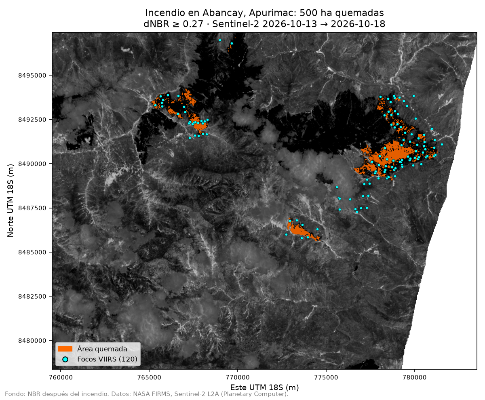

# Reto A · Del foco de calor a la hectárea: midiendo el incendio de Abancay (octubre de 2026)

**Pregunta guía:** ¿cuánto territorio se quemó en octubre de 2026 en el incendio de Abancay (Apurímac), según imágenes
Sentinel-2 y el índice dNBR?

**Respuesta breve**: unas **500 hectáreas**, repartidas en tres cicatrices principales, con 120 focos de calor
detectados en la zona. Es una estimación: cambia mucho con el umbral de dNBR (de 81 a 1 261 ha según el umbral) y las
nubes de la imagen posterior pueden esconder parte del área. Los detalles están abajo.

## 1. Datos y fechas

| Fuente | Qué se usó | Detalle |
|---|---|---|
| NASA FIRMS | Focos de calor VIIRS, Sudamérica, últimos 7 días | 120 focos (confianza nominal o alta) en la zona, 14–19 de octubre de 2026 |
| Sentinel-2 L2A (Microsoft Planetary Computer) | Bandas B8A (NIR) y B12 (SWIR) a 20 m, y SCL para nubes | tile 18LYK |
| ESA WorldCover 2021 (Planetary Computer) | Tipo de cobertura del área quemada | 10 m, remuestreado a 20 m |
| `juaneladio/peru-geojson` | Límite provincial, solo para nombrar la ubicación | |

| Imagen | Fecha | Nubosidad (escena) | Nubosidad (zona de estudio) |
|---|---|---:|---:|
| Antes | 2026-10-13 | 0 % | 0 % |
| Después | 2026-10-18 | 12 % | 11 % |

**Zona de estudio:** lon −72.60 a −72.38, lat −13.75 a −13.58, unos 457 km² (369 km² sin nubes en ninguna de las dos
fechas). Se eligió porque concentra focos y tiene imágenes casi sin nubes; Río Tambo (Junín) tenía entre 40 y 90 % de
nubes en todas las fechas. La imagen del 20 de octubre tenía 93 % de nubes y no se pudo usar.

## 2. Método

FIRMS → seleccionar incendio → Sentinel-2 antes/después → NBR → dNBR → máscara → hectáreas.

1. `NBR = (B8A − B12) / (B8A + B12)`, con reflectancia = (DN − 1000) / 10000 (baseline de procesamiento 05.13).
2. `dNBR = NBR_antes − NBR_después`. Se descartan nubes y cirros en ambas fechas con la banda SCL.
3. **Umbral: dNBR ≥ 0.27**, el límite del USGS para severidad moderada-baja o mayor. Se fijó antes de ver el resultado y
   no se ajustó.
4. Solo se cuentan los píxeles a ≤ 1 km de un foco VIIRS, para descartar cambios que no son fuego (cultivos, por
   ejemplo). Casi no cambia el resultado: sin ese filtro salen 509 ha.
5. Hectáreas = píxeles quemados × 400 m² ÷ 10 000. La cifra sale directamente del código. El área se calcula sobre
   píxeles de 20 m en UTM 18S (EPSG:32718, en metros): en EPSG:4326 las unidades son grados y el área no tendría sentido.
6. **Validación independiente** (sin el filtro de focos): de los 107 focos anteriores a la imagen «después» y sobre
   píxeles sin nubes, el 100 % tiene un píxel quemado a ≤ 1 km. Los 13 focos del 19 de octubre quedan a 0,5–2 km de lo ya
   quemado (mediana 1,8 km): puede ser fuego que avanzó o focos nuevos tras la imagen.

**Sobre el `nodata`.** Los archivos Sentinel-2 L2A no lo declaran (`src.nodata` es `None`). Por convención del producto el
0 es «sin dato», así que se convierte a `NaN` a mano (6 % y 8 % de los píxeles de la zona en cada imagen, el borde del tile).

## 3. Resultado

# 500 hectáreas quemadas



La comparación de NBR antes y después y el dNBR están en [`outputs/nbr_antes_despues.png`](outputs/nbr_antes_despues.png).

### Tres hallazgos
1. **500 ha** quemadas (12 503 píxeles de 20 m con dNBR ≥ 0.27); el dNBR medio del área quemada es 0.36.
2. **120 focos VIIRS** en la zona entre el 14 y el 19 de octubre.
3. **73 % del área quemada era pastizal** (20 % bosque, 7 % matorral), según ESA WorldCover 2021.

### Limitaciones
1. **Un foco no es un incendio completo:** es un píxel de 375 m donde VIIRS detectó calor. 13 de los 120 focos son
   posteriores a la imagen «después» (19 de octubre) y quedan a 0,5–2 km de lo mapeado, así que su área no está medida y
   el total probablemente se queda corto.
2. **Nubes:** el 11 % de la zona tiene nubes en la imagen posterior, junto a la cicatriz más grande. 4 focos caen sobre
   píxeles enmascarados, por lo que el área puede estar subestimada.
3. **El área depende del umbral:** con dNBR ≥ 0.10 saldrían 1 261 ha y con ≥ 0.44, 81 ha.
4. **Las fechas importan** y el resultado es una **estimación** satelital, no una medición en campo.

## 4. Cómo correrlo

```bash
cd proyecto-incendios
uv sync --group geo --group raster                     # desde la raíz del repo
uv pip install pystac-client planetary-computer        # solo si el entorno no los tiene (vienen con el grupo hf)
uv run jupyter lab                                     # abrir incendio_dnbr.ipynb
```

- `incendio_dnbr.ipynb` tarda ≈ 45 s en CPU y descarga solo la ventana de la zona de estudio, no escenas completas.
  Necesita internet para consultar Planetary Computer.
- Los focos FIRMS cubren «los últimos 7 días» y esa ventana se mueve. Por eso se versiona el CSV descargado el
  21 de octubre de 2026 (`data/firms_viirs_sudamerica_7d.csv`): con él el notebook da siempre el mismo resultado.
- `presentacion.html` se abre con doble clic y se navega con las flechas ← →. Las cifras de las diapositivas se
  escribieron a partir de la salida del notebook; si algo cambia, hay que actualizarlas.
- `dashboard.html` es una alternativa en una sola página (modo claro y oscuro, y los datos de los gráficos también en
  tabla). Ambos archivos necesitan la carpeta `outputs/` al lado para mostrar las imágenes.

## 5. Estructura

```text
proyecto-incendios/
├── incendio_dnbr.ipynb       # FIRMS, Sentinel-2, NBR/dNBR, hectáreas, WorldCover, mapas y hallazgos
├── presentacion.html         # 5 diapositivas para exponer
├── dashboard.html            # alternativa: una página con 3 hallazgos, mapa, gráficos y limitaciones
├── dashboard_compartible.html  # el mismo dashboard con las imágenes incrustadas (191 KB), sin depender de outputs/
├── data/
│   ├── firms_viirs_sudamerica_7d.csv   # focos VIIRS de Sudamérica (descarga del 21-oct-2026)
│   ├── focos_incendio.csv    # focos dentro de la zona de estudio
│   └── peru_provincial.geojson
└── outputs/
    ├── mapa_area_quemada.png
    ├── nbr_antes_despues.png
    └── resumen_incendio.csv  # fechas, nubes, focos, umbral y hectáreas
```

## 6. Uso de IA

Un asistente de IA (Claude Code) escribió el código del notebook, la presentación y este README a partir de las
indicaciones de la tarea. La elección del incendio, las fechas, el umbral y la lectura de resultados se revisaron contra
las salidas del notebook y los mapas.
